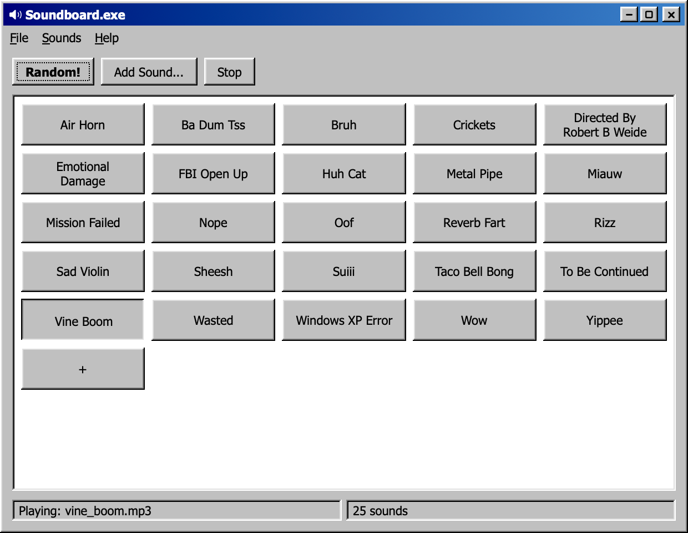

# Soundboard

A Windows 95 style soundboard for macOS, written in SwiftUI.



Click a pad to play it. Space plays a random sound and Esc stops playback.

## Install

Download `Soundboard.dmg` from the [latest release](../../releases/latest) and drag the app to Applications. Requires macOS 15 or later.

## Adding sounds

Every audio file in `~/Soundboard` is a pad, labeled with its file name: `sad_trombone.mp3` shows as "Sad Trombone". The app watches that folder, so new files show up right away.

- **By hand:** drop files on the window, click `+` or use File > Add Sound.
- **From an AI agent:** have it copy an audio file into `~/Soundboard`. The folder has a README that tells agents how.

On first launch the folder gets the built-in macOS alert sounds so the board isn't empty. Right-click a pad to show it in Finder or move it to the Trash.

## Build from source

```sh
./build.sh
open build/Soundboard.app
```

`swift run` works too for quick iteration.

## Releases

GitHub Actions builds a DMG on every push. Push a `v*` tag to publish it as a release:

```sh
git tag v1.0.0 && git push origin v1.0.0
```

Signing and notarization use a Developer ID .p12 and an App Store Connect API key. The workflow file lists the secret names.

## License

MIT
